# คู่มือใช้งาน InsightX Tailwind

## 1. เริ่มต้นและรู้จักหน้าจอ

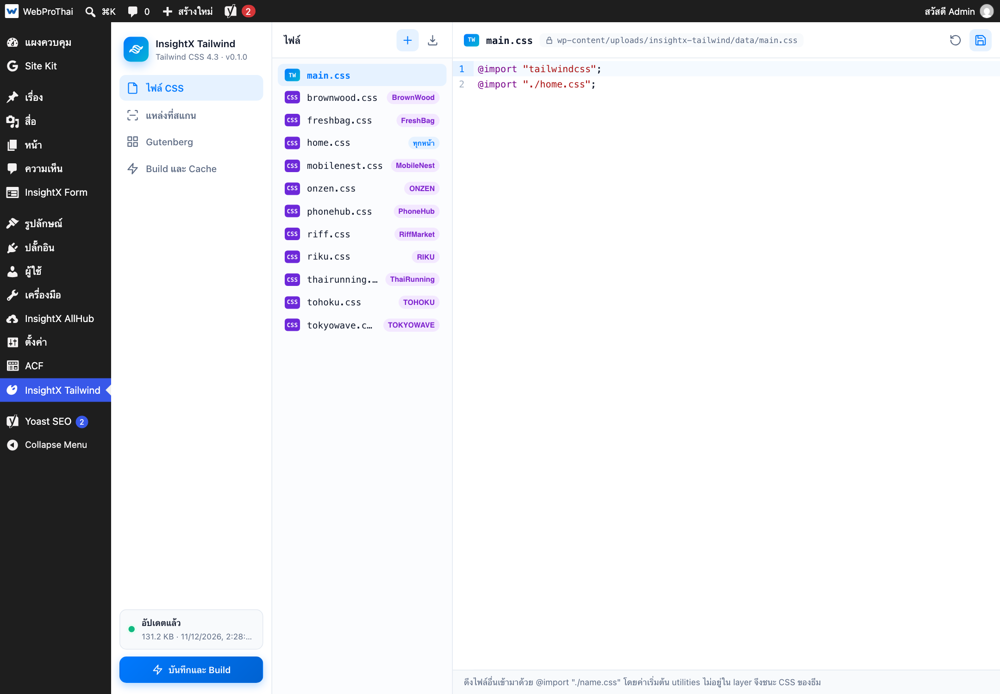

1. เข้าสู่ระบบ WordPress ด้วยบัญชีผู้ดูแลระบบ
2. เลือก **InsightX Tailwind** จากเมนูด้านซ้ายของ WordPress
3. เลือกงานที่ต้องการจากเมนูภายในปลั๊กอิน ได้แก่ **ไฟล์ CSS**, **แหล่งที่สแกน**, **Gutenberg** และ **Build และ Cache**
4. ดูสถานะและปุ่ม **บันทึกและ Build** ที่มุมซ้ายล่าง

**อ่านภาพ:** คอลัมน์ซ้ายสุดเป็นเมนู WordPress ถัดมาเป็นเมนูปลั๊กอิน ตรงกลางเป็นรายการไฟล์ และด้านขวาเป็นพื้นที่แก้ไข CSS ในภาพเลือกไฟล์ `main.css` อยู่

**ก่อนใช้ครั้งแรก:** ติดตั้งไฟล์ zip สำหรับติดตั้งจากหน้า Releases ของโครงการ แล้วเปิดใช้งานปลั๊กอิน ตรวจแหล่งสแกนและกด **บันทึกและ Build** อย่างน้อยหนึ่งครั้ง ผู้เข้าชมจึงจะได้รับ CSS ที่สร้างไว้ ไม่ต้องติดตั้ง Node.js บนเซิร์ฟเวอร์เพื่อใช้งานปลั๊กอิน

**ลำดับงานประจำ:** แก้ CSS หรือเนื้อหา → บันทึก → Build → ตรวจหน้าเว็บ → เปิดเว็บจริงตรวจหน้าตา

## 2. แก้ไข main.css และ CSS ที่ใช้ทุกหน้า


1. เลือกเมนู **ไฟล์ CSS** แล้วคลิก `main.css`
2. แก้ไข CSS หรือนำเข้าไฟล์อื่นด้วยคำสั่ง `@import`
3. กด **บันทึกและ Build** หรือกด `⌘S` บน Mac / `Ctrl+S` บน Windows
4. รอจน Build เสร็จ แล้วเปิดหน้าจริงเพื่อตรวจผล

```css
/* เพิ่มใน main.css เมื่อต้องการใช้ไฟล์นี้ทุกหน้า */
@import "./home.css";
```

**อ่านภาพ:** `home.css` มีป้าย **ทุกหน้า** เพราะ `main.css` นำเข้าไฟล์นี้อยู่ ชื่อไฟล์ไม่ได้เป็นตัวกำหนดขอบเขตการใช้งาน แม้จะชื่อ home.css ก็มีผลทุกหน้าเมื่อ import จาก main.css

**ปุ่มมุมขวาบน:** ลูกศรวนใช้คืนเนื้อหา main.css เป็นค่าเริ่มต้น ส่วนรูปแผ่นดิสก์ใช้บันทึกและ Build การคืนค่าเริ่มต้นจะแทนที่เนื้อหาในตัวแก้ไข ควรคัดลอกของเดิมเก็บไว้ก่อน และตรวจให้เรียบร้อยก่อนบันทึก

**เกี่ยวกับ CSS ของธีม:** ค่าเริ่มต้นของปลั๊กอินแยกนำเข้า utilities โดยไม่ใส่ layer เพื่อช่วยให้ใช้ร่วมกับธีมได้ แต่ไฟล์เดิมของเว็บอาจยังใช้ `@import "tailwindcss";` ดังในภาพ อย่าเปลี่ยนส่วน import ทั้งชุดโดยไม่ตรวจผลกับธีม

## 3. สร้างไฟล์ CSS ใหม่


1. คลิกปุ่ม **+** ด้านบนรายการไฟล์
2. พิมพ์ชื่อ เช่น `landing.css` แล้วกด Enter
3. ระบบสร้างไฟล์และเพิ่ม `@import "./landing.css";` ใน main.css ให้อัตโนมัติ
4. ใส่ CSS ที่ต้องการ แล้วกด **บันทึกและ Build**

**ชื่อไฟล์:** ใช้อักษรอังกฤษ ตัวเลข จุด ขีดกลาง หรือขีดล่าง เริ่มด้วยอักษรอังกฤษหรือตัวเลข ระบบปรับเป็นตัวพิมพ์เล็กและเติม `.css` ให้หากไม่ได้พิมพ์นามสกุล ไม่ใช้โฟลเดอร์ย่อยในชื่อไฟล์

**ผลที่ได้:** ไฟล์ที่สร้างใหม่จะมีผลทุกหน้าในตอนแรก เพราะระบบเพิ่ม import ให้อัตโนมัติ หากต้องการใช้เฉพาะหน้า ให้ทำตามหัวข้อถัดไปก่อนบันทึก

**การลบ:** เลือกไฟล์ที่ไม่ใช่ main.css แล้วกดรูปถังขยะ ยืนยันการลบ และลบบรรทัด import ของไฟล์นั้นออกจาก main.css ด้วย มิฉะนั้น Build อาจแจ้งว่าไม่พบไฟล์ ระบบไม่ให้ลบ main.css ผ่านปุ่มนี้

## 4. แยก CSS สำหรับแต่ละหน้า

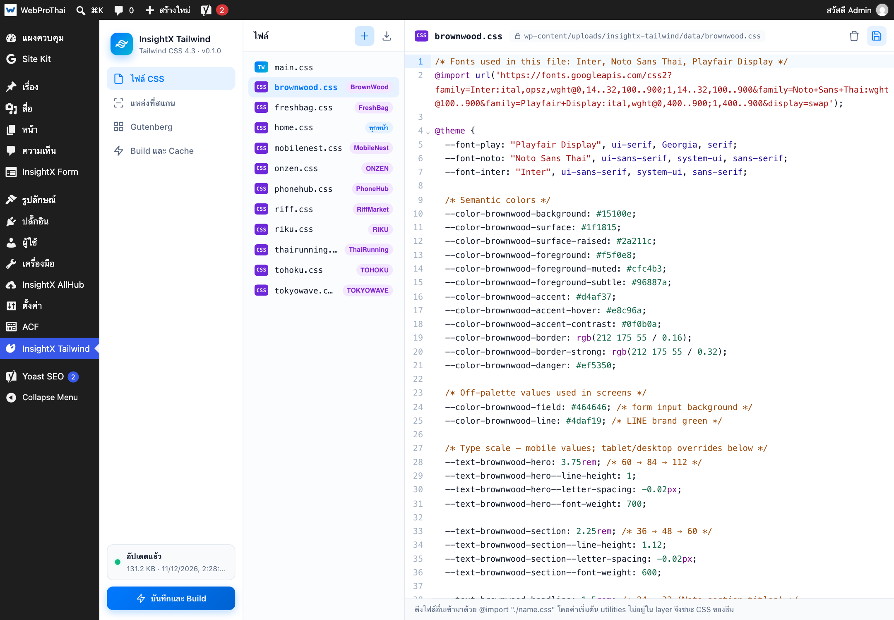

1. สร้างไฟล์ เช่น `landing.css` จากหน้าไฟล์ CSS
2. ลบบรรทัด `@import "./landing.css";` ที่ระบบเพิ่มให้ ออกจาก main.css เพื่อให้ไฟล์นี้ไม่ถูกใช้ทุกหน้า
3. กด **บันทึกและ Build** เพื่อเก็บไฟล์และการเปลี่ยนแปลง
4. เปิดหน้าแก้ไขเรื่องหรือหน้าที่จะใช้ไฟล์ แล้วเลือกไฟล์ในแผง **CSS เฉพาะหน้า** ตามหัวข้อ 5

**อ่านภาพ:** `brownwood.css` มีป้าย **BrownWood** หมายถึงไฟล์นี้ผูกกับเนื้อหาชื่อนั้น ขณะที่ home.css มีป้าย **ทุกหน้า** หากไฟล์ยังไม่ถูก import และยังไม่ผูกกับหน้าใด ระบบจะแสดงว่ายังไม่ถูกใช้งาน

**ขอบเขตของไฟล์:** main.css เป็นไฟล์หลักของเว็บ ไฟล์ที่นำเข้าจาก main.css ใช้ทุกหน้า ส่วนไฟล์ที่ไม่ได้ import สามารถเลือกผูกกับเรื่องหรือหน้าเป็นรายรายการได้ หน้าเดียวสามารถเลือกได้หลายไฟล์

## 5. เลือกไฟล์ในแผง CSS เฉพาะหน้า

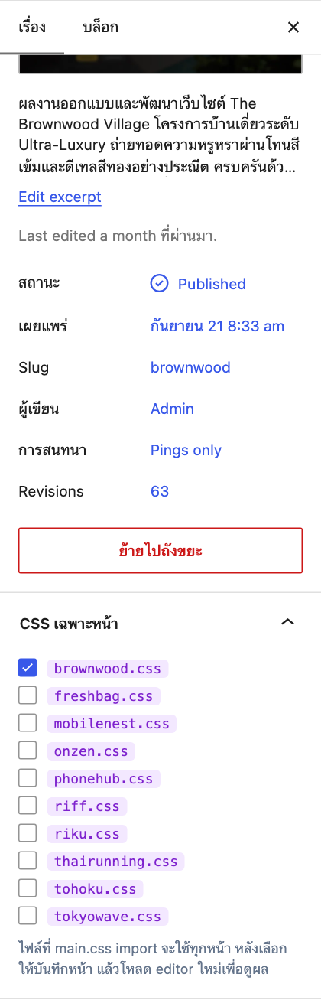

1. เปิดหน้าแก้ไขเนื้อหาที่ต้องการ อาจเป็น **หน้า** หรือ **เรื่อง** ตามโครงสร้างเว็บ
2. เปิดแถบ Settings ด้านขวา แล้วเลือกแท็บของเอกสาร เช่น **หน้า** หรือ **เรื่อง**
3. เลื่อนหาแผง **CSS เฉพาะหน้า** แล้วติ๊กไฟล์ที่จะใช้
4. กด **บันทึก** หรือ **อัปเดต** เนื้อหา รอการ Build แล้วโหลด editor ใหม่เพื่อดูตัวอย่างที่ใช้ชุดไฟล์ล่าสุด
5. หากบันทึกด้วยบัญชีที่ไม่มีสิทธิ์ Build ให้ผู้ดูแลเปิด InsightX Tailwind และกด **บันทึกและ Build**

**อ่านภาพ:** หน้า BrownWood เลือก brownwood.css อยู่ ส่วนไฟล์อื่นไม่ได้เลือก จึงใช้ main.css ร่วมกับ brownwood.css สำหรับหน้านี้

**ถ้าหาไฟล์ไม่เจอ:** ตรวจว่าได้บันทึกไฟล์จากหน้าปลั๊กอินแล้ว และ main.css ไม่ได้นำเข้าไฟล์นั้น จากนั้นโหลดหน้าแก้ไขใหม่ ไฟล์ที่ใช้ทุกหน้าจะไม่อยู่ในรายการให้เลือกซ้ำ

**ผลที่ได้:** เมื่อ Build สำเร็จ ระบบสร้างชุด CSS ของหน้าที่ผูกไฟล์ไว้ โดยรวม CSS หลักและไฟล์ที่เลือกให้แล้ว ไม่ต้องเพิ่มแท็ก link เอง

## 6. เลือกแหล่งที่สแกน

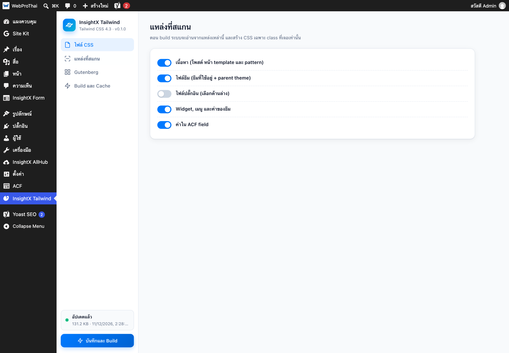

1. เปิดเมนู **แหล่งที่สแกน**
2. เปิดแหล่งข้อมูลที่เก็บ class ของเว็บ
3. กด **บันทึกและ Build** เพื่อให้ตัวเลือกมีผลกับ CSS ที่ผู้เข้าชมได้รับ

| แหล่งข้อมูล | ใช้เมื่อ |
| --- | --- |
| เนื้อหา | มี class ในเรื่องหรือหน้าสาธารณะที่เผยแพร่แล้วและไม่ตั้งรหัสผ่าน |
| ไฟล์ธีม | มี class ในไฟล์ของธีมที่ใช้อยู่หรือ parent theme |
| ไฟล์ปลั๊กอิน | ปลั๊กอินสร้างส่วนแสดงผลที่มี Tailwind classes ต้องเลือกชื่อปลั๊กอินเพิ่มด้วย |
| Widget, เมนู และค่าของธีม | สแกนเมนูที่เผยแพร่แล้ว; วิดเจ็ตและค่าธีมต้องให้ผู้พัฒนาอนุญาตชื่อ option ก่อน |
| ค่าใน ACF field | สแกนเฉพาะชื่อฟิลด์ที่ผู้พัฒนาระบุว่าเผยแพร่ได้; แสดงเมื่อเว็บมี ACF และตั้งค่ารายการนี้แล้ว |
| Elementor data | ใช้ Elementor และมี class ในข้อมูลของ editor; แสดงเมื่อเว็บมี Elementor |

**อ่านภาพ:** ตัวเลือก ACF จะปรากฏเมื่อมี ACF และผู้พัฒนาระบุชื่อฟิลด์สาธารณะแล้ว ส่วน Elementor จะปรากฏเมื่อเปิดใช้ปลั๊กอินที่เกี่ยวข้อง

**หลักการ:** Build อ่าน class จากแหล่งที่เปิดไว้ แล้วสร้าง utilities ที่พบ ควรมีชื่อ class แบบเต็มอยู่ในข้อมูลที่สแกนได้ การประกอบชื่อ class จากสตริงหลายส่วนในโค้ดอาจทำให้ scanner ไม่พบ

## 7. เลือกปลั๊กอินที่จะสแกน

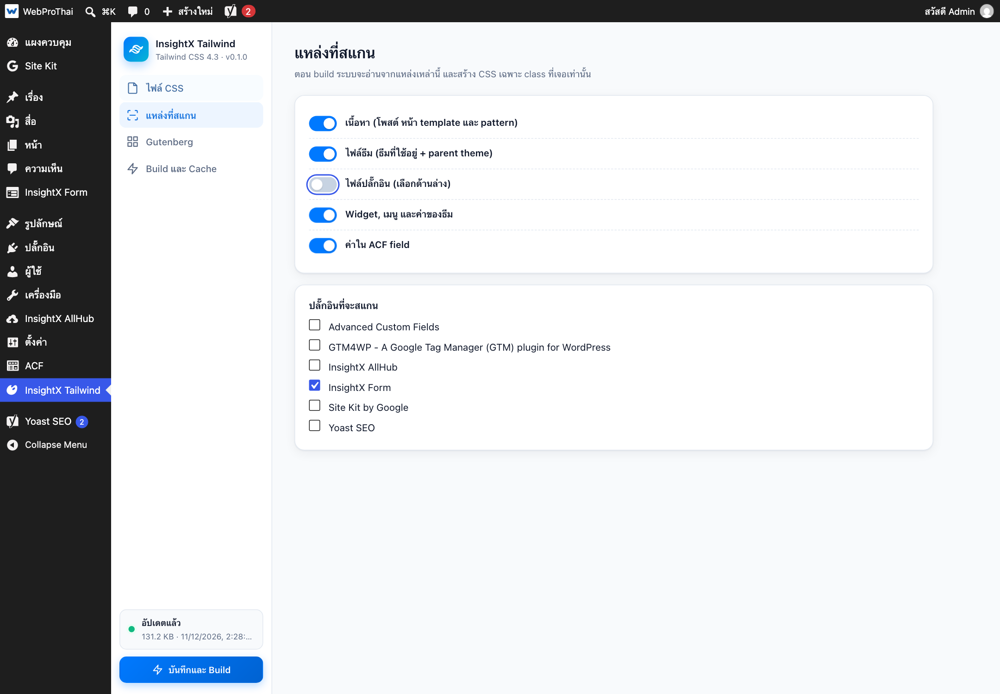

1. เปิด **ไฟล์ปลั๊กอิน (เลือกด้านล่าง)** ในหน้าแหล่งที่สแกน
2. ในรายการ **ปลั๊กอินที่จะสแกน** ติ๊กเฉพาะปลั๊กอินที่มี class ที่เว็บต้องใช้
3. กด **บันทึกและ Build**

**อ่านภาพ:** รายชื่อด้านล่างจะปรากฏเมื่อเปิดแหล่งสแกนไฟล์ปลั๊กอิน การเปิดสวิตช์อย่างเดียวโดยไม่เลือกชื่อปลั๊กอินยังไม่ได้ระบุไฟล์ที่จะสแกน

**ใช้กรณีใด:** เช่น มีปลั๊กอินของเว็บที่สร้างการ์ดสินค้า ปุ่ม หรือรายการข้อมูลพร้อม Tailwind classes การเลือกให้ตรงกับที่ใช้งานช่วยลดไฟล์ที่ต้องอ่านระหว่าง Build

## 8. ตั้งค่าตัวอย่าง Gutenberg และชุดสี

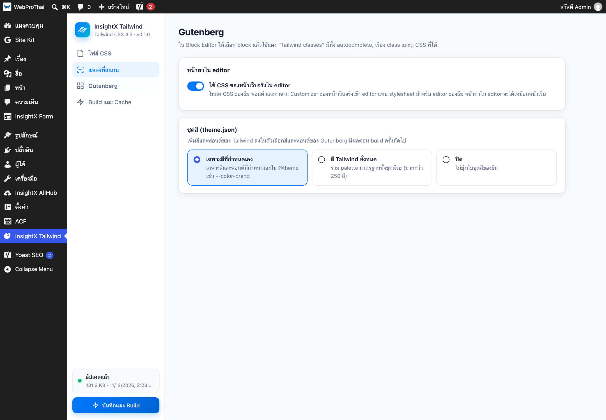

1. เปิดเมนู **Gutenberg** ในหน้าปลั๊กอิน
2. เปิด **ใช้ CSS หน้าเว็บจริงใน editor** เมื่อต้องการให้พื้นที่แก้ไขโหลด CSS ธีม ฟอนต์ และค่าของหน้าเว็บจริง
3. เลือกโหมดชุดสีที่ต้องการ
4. กด **บันทึกและ Build** จากนั้นโหลด editor ใหม่

| ตัวเลือกชุดสี | ผลที่ได้ |
| --- | --- |
| เฉพาะสีที่กำหนดเอง | เพิ่มสีและตระกูลฟอนต์ที่กำหนดเองใน @theme |
| สี Tailwind ทั้งหมด | เพิ่มชุดสีเริ่มต้นของ Tailwind ด้วย ทำให้มีตัวเลือกจำนวนมาก |
| ปิด | ไม่เพิ่มชุดสีและฟอนต์จาก Tailwind ผ่านการตั้งค่านี้ |

**ตัวอย่างกำหนดสี:** เพิ่มใน main.css หรือไฟล์ที่ main.css import แล้ว Build ใหม่

```css
@theme {
  --color-brand: #2563eb;
}
```

สีนี้ใช้กับ utility เช่น `bg-brand` หรือ `text-brand` และเข้าไปอยู่ในตัวเลือกสีของ Gutenberg ตามโหมดที่เลือก การแสดงผลใน editor ยังขึ้นกับธีม ขนาดพื้นที่แก้ไข และสคริปต์ของหน้าเว็บ ควรตรวจหน้าจริงร่วมด้วย

## 9. ใส่ Tailwind classes ให้บล็อก

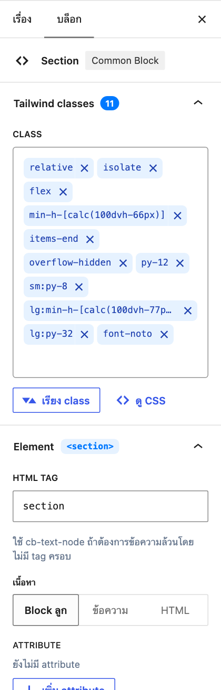

1. เปิดหน้าแก้ไขเนื้อหาด้วย Gutenberg
2. คลิกเลือกบล็อกที่ต้องการ แล้วเปิดแท็บ **บล็อก** ในแถบขวา
3. ในแผง **Tailwind classes** พิมพ์ชื่อ class เช่น `p-4`, `rounded-xl` หรือ `md:flex`
4. เลือกคำแนะนำหรือยืนยันแต่ละ class ระบบแสดงชื่อที่เพิ่มแล้วเป็นรายการในช่อง
5. ใช้ **เรียง class** เมื่อต้องการจัดลำดับ แล้วบันทึกเนื้อหา

**ตัวอย่าง:** `p-4 rounded-xl bg-brand text-white` ใช้ระยะห่างภายใน มุมโค้ง สีพื้นหลังแบรนด์ และตัวอักษรสีขาว โดย bg-brand ต้องกำหนดสีไว้ก่อนตามหัวข้อ 8

**อ่านภาพ:** บล็อก section มี class สำหรับการจัดวางและขนาดหลายหน้าจอ เช่น `flex`, `items-end`, `sm:py-8` และ `lg:py-32` ตัวเลขข้างชื่อแผงคือจำนวน class ของบล็อกที่เลือก

**เมื่อบันทึก:** สำหรับผู้ดูแลที่มีสิทธิ์ Build ปลั๊กอินจะสั่งสร้าง cache หลังการบันทึกเนื้อหาด้วยตนเอง การเห็นตัวอย่างใน editor อย่างเดียวไม่ได้ยืนยันว่า cache ของผู้เข้าชมเป็นชุดล่าสุด

## 10. ดู CSS ที่สร้าง และใช้ Common Block

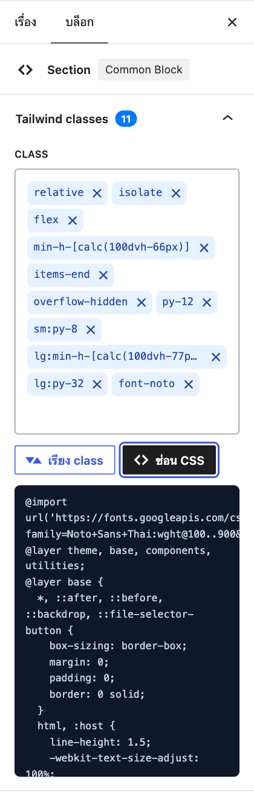

1. เลือกบล็อกที่มี Tailwind classes
2. กด **ดู CSS** เพื่ออ่านกฎที่สร้างจาก class ของบล็อกนั้น
3. กด **ซ่อน CSS** เมื่อต้องการกลับไปใช้พื้นที่ตั้งค่าตามปกติ

**ใช้ตรวจอะไร:** ดูว่า utility สร้างกฎตามที่ต้องการหรือไม่ เช่น padding, display หรือ breakpoint ผลในแผงนี้สร้างจาก class ที่เลือกและ CSS หลัก จึงควรตรวจหน้าเว็บจริงร่วมด้วยเมื่อใช้ตัวแปรหรือกฎจากไฟล์เฉพาะหน้า

**Common Block:** ปลั๊กอินรองรับบล็อกเดิมของ WindPress เมื่อเลือกบล็อกชนิดนี้จะมีแผง **Element** ใต้ Tailwind classes สำหรับกำหนด HTML tag, รูปแบบเนื้อหา และ attributes

| ส่วนตั้งค่า | ความหมาย |
| --- | --- |
| HTML tag | ระบุชนิด element เช่น section, div, p หรือ a |
| Block ลูก | ใช้เป็นตัวครอบบล็อกอื่น |
| ข้อความ / HTML | กำหนดเนื้อหาของ element นั้น |
| Attribute | เพิ่มค่า เช่น id, href, alt หรือ data-* ตามชนิด element |

บล็อกชนิดรูปภาพและ tag ที่ไม่มี tag ปิดมีพฤติกรรมต่างจากตัวครอบบล็อก ใช้ `cb-text-node` เมื่อต้องการข้อความล้วนโดยไม่มี tag ครอบ และอย่าปิดปลั๊กอินที่ทำหน้าที่แสดง Common Block โดยไม่มีตัวแทน เพราะเนื้อหาเดิมอาจไม่แสดง

## 11. บันทึกและ Build ให้ผู้เข้าชมได้รับ CSS ล่าสุด

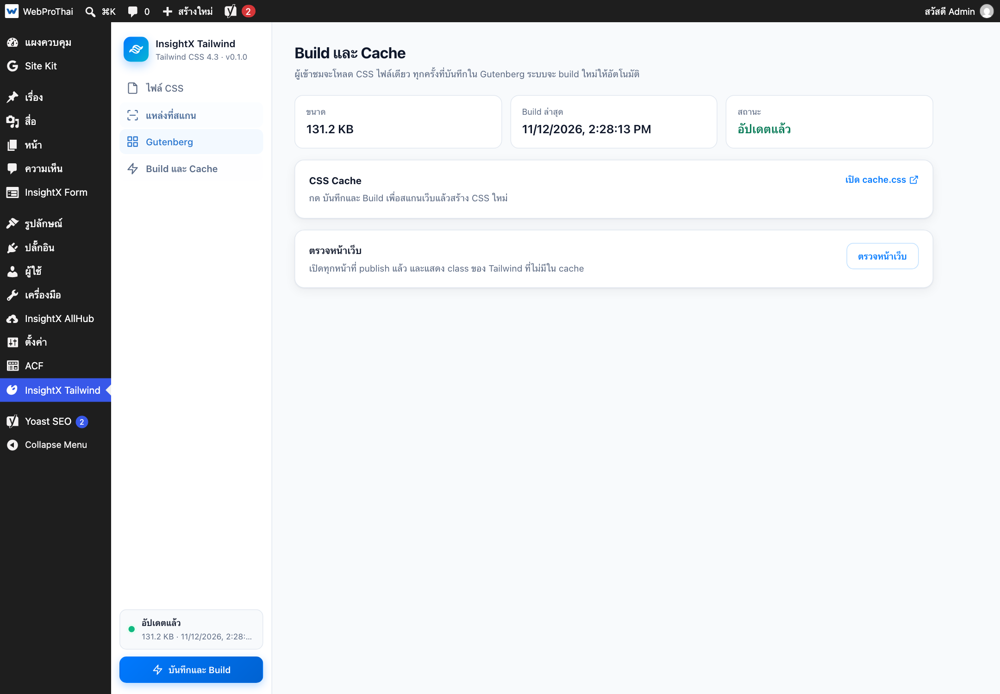

1. กด **บันทึกและ Build** จากเมนูด้านซ้ายหรือปุ่มรูปแผ่นดิสก์ในหน้าไฟล์ CSS
2. รอจนข้อความกำลัง Build หายไปและระบบแจ้งสำเร็จ
3. เปิดเมนู **Build และ Cache** เพื่อตรวจเวลา Build ล่าสุดและสถานะ
4. ใช้ **เปิด cache.css** เมื่อต้องการดูไฟล์ CSS หลักที่สร้างแล้ว

| สถานะ | สิ่งที่ควรทำ |
| --- | --- |
| ยังไม่ Build | สั่งบันทึกและ Build ก่อนให้ผู้เข้าชมใช้ Tailwind |
| ต้อง Build ใหม่ | เนื้อหาเปลี่ยนจากชุดที่สร้างไว้ ให้สร้างใหม่แล้วตรวจผล |
| อัปเดตแล้ว | ระบบมี cache ล่าสุดตามสถานะที่บันทึกไว้ ให้ตรวจหน้าเว็บต่อ |

**อ่านภาพ:** ขนาด 131.2 KB และเวลา Build เป็นข้อมูลของ cache หลักในเว็บตัวอย่าง หน้าอื่นที่ผูก CSS เฉพาะหน้าอาจใช้ไฟล์ CSS ของตัวเอง

**ควร Build เมื่อใด:** หลังแก้ไฟล์ CSS, เปลี่ยนแหล่งสแกน, เปลี่ยนชุดสี, เปลี่ยนการผูก CSS เฉพาะหน้า หรือแก้ส่วนที่มี class ใหม่ หากแก้เนื้อหานอก Gutenberg อย่าอาศัยการ Build อัตโนมัติจาก editor

**ข้อสังเกต:** ถ้าเปิดหน้าปลั๊กอินขณะ cache ถูกระบุว่าเก่าและเคย Build แล้ว ระบบอาจเริ่ม Build ให้อัตโนมัติ หากเกิดข้อผิดพลาดให้แก้ตามข้อความและ Build อีกครั้ง ไม่ควรดูเฉพาะจุดสถานะสีเขียวเพื่อยืนยันว่าทุกหน้าถูกต้อง

## 12. ตรวจหน้าเว็บและอ่านผล class ที่ขาด

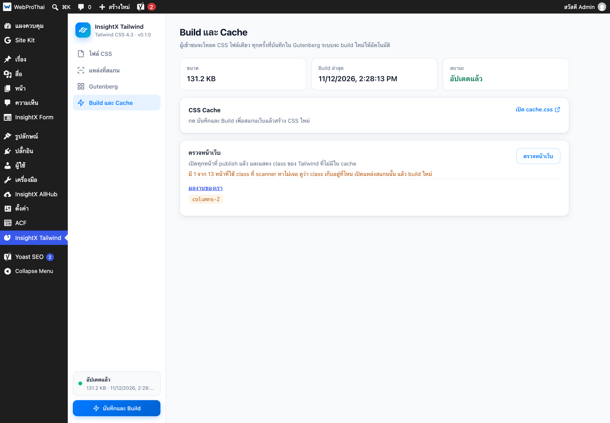

1. เปิด **Build และ Cache** หลังสร้าง cache แล้ว
2. กด **ตรวจหน้าเว็บ** รอระบบตรวจ URL ที่เผยแพร่แล้ว
3. หากไม่พบ class ขาด ระบบจะแสดงจำนวนหน้าที่ตรวจครอบคลุม
4. หากพบปัญหา ให้อ่านชื่อหน้าและ class ที่แสดง แล้วตรวจว่าข้อมูลนั้นเก็บอยู่ในเนื้อหา ธีม ปลั๊กอิน ACF หรือแหล่งอื่น
5. เปิดแหล่งสแกนที่เกี่ยวข้อง ตรวจว่าชื่อ class อยู่ในรูปแบบเต็มที่สแกนได้ จากนั้น **บันทึกและ Build** และตรวจซ้ำ

**อ่านภาพ:** ในวันจัดทำคู่มือ ระบบตรวจ 13 URL และรายงาน 1 หน้าที่มี class ขาด คือหน้า **ผลงานของเรา** ซึ่งมี `columns-2` ภาพนี้เป็นตัวอย่างผลตรวจจริง ไม่ใช่ข้อความยืนยันว่าเว็บผ่านครบแล้ว คู่มือนี้ไม่ได้เปลี่ยนการตั้งค่าหรือแก้ class ดังกล่าว

**ขอบเขตการตรวจ:** ระบบตรวจ class ที่อ่านได้จาก HTML ของ URL ในรายการเผยแพร่ และเทียบกับไฟล์ CSS ของแต่ละหน้า การไม่พบ class ขาดไม่ได้ยืนยันเรื่องหน้าตา การทำงานของ JavaScript หรือทุกสถานะที่เกิดหลังคลิกใช้งาน ต้องเปิดหน้าเว็บทดสอบประกอบ

หากผลแสดงข้อผิดพลาดการโหลดหน้า ให้ตรวจว่า URL และไฟล์ CSS เข้าถึงได้ก่อน ข้อผิดพลาดการโหลดไม่ได้แปลว่า class ขาดเสมอไป

## 13. ตรวจผลหน้าเว็บจริง

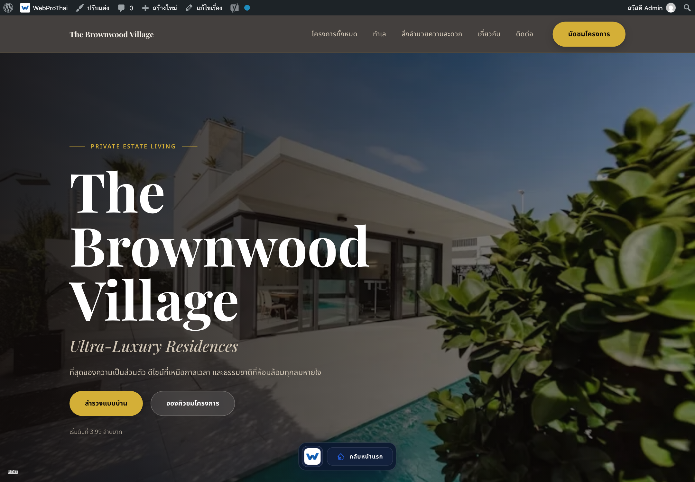

1. เปิดหน้าเว็บที่แก้ไขในแท็บใหม่ และโหลดใหม่หลัง Build
2. ตรวจสี ฟอนต์ ระยะห่าง ปุ่ม และส่วนหัว/ท้าย
3. ปรับความกว้างหน้าต่างเพื่อตรวจมือถือ แท็บเล็ต และเดสก์ท็อป โดยเฉพาะ class ที่มี `sm:`, `md:` หรือ `lg:`
4. ตรวจหน้าอื่นด้วยหากเปลี่ยน main.css หรือไฟล์ที่ใช้ทุกหน้า
5. ถ้าเว็บมีระบบ cache ของหน้าเว็บหรือ CDN และยังเห็นผลเก่า ให้ล้าง cache ของระบบนั้นแล้วตรวจซ้ำ

**อ่านภาพ:** หน้า BrownWood ใช้ CSS หลักร่วมกับ brownwood.css ภาพนี้เป็นผลแสดงจริงของเว็บตัวอย่าง ชื่อ สี และข้อความของเว็บอื่นจะแตกต่างกัน

## 14. ย้ายจาก WindPress และกรณีใช้ Elementor


**ย้ายจาก WindPress**

1. สำรองไฟล์ CSS เดิมก่อนเริ่ม แล้วเปิด **InsightX Tailwind → ไฟล์ CSS**
2. คลิกไอคอนนำเข้า ซึ่งเป็นรูปลูกศรลงด้านขวาของปุ่ม **+** ปุ่มนี้แสดงเมื่อระบบพบข้อมูล WindPress
3. อ่านคำยืนยันและยอมรับเมื่อพร้อม ไฟล์ชื่อซ้ำจะถูกแทนที่ในชุดไฟล์ที่กำลังแก้ไข
4. ตรวจ main.css และไฟล์ที่นำเข้า ระบบปรับส่วน import ของ Tailwind สำหรับการใช้งานร่วมกับธีม
5. กด **บันทึกและ Build** ตรวจหน้าเว็บ และตรวจ Common Block เดิม
6. ปิด WindPress หลังเตรียม InsightX Tailwind ให้ทำงานแทนเรียบร้อย แล้วตรวจผลอีกครั้ง

**อ่านภาพ:** เว็บตัวอย่างแสดงปุ่มนำเข้าอยู่ แต่ไม่ได้กดนำเข้าจริงระหว่างทำคู่มือ เพื่อคงไฟล์และการตั้งค่าเดิม หากระบบแจ้งไม่พบไฟล์ ให้ตรวจข้อมูลเดิมใน uploads/windpress/data/ หรือให้ผู้ดูแลระบบช่วยตรวจ

**กรณีใช้ Elementor:** เลือก element ที่ต้องการ เปิดส่วน Advanced แล้วใส่ชื่อ class ในช่อง CSS Classes โดยไม่เติมจุดนำหน้า ปลั๊กอินรองรับคำแนะนำ class และตัวอย่างในพื้นที่ Elementor เปิดแหล่งสแกน Elementor data แล้ว Build หลังแก้ไข เว็บตัวอย่างไม่มี Elementor จึงไม่มีภาพขั้นตอนจาก editor นี้

## 15. แก้ปัญหาที่พบบ่อยและตรวจงานก่อนส่ง

| อาการ | วิธีตรวจและดำเนินการ |
| --- | --- |
| editor แสดงผลแล้วแต่หน้าเว็บยังไม่เปลี่ยน | บันทึกเนื้อหา ให้ผู้ดูแล Build ตรวจเวลา cache และโหลดหน้าเว็บใหม่ |
| Build แจ้งหาไฟล์ import ไม่พบ | ตรวจชื่อไฟล์กับบรรทัด @import โดยเฉพาะไฟล์ที่เพิ่งลบ |
| CSS ที่ตั้งใจใช้หน้าเดียวไปมีผลทุกหน้า | ตรวจ main.css และเอา import ของไฟล์นั้นออก แล้วเลือกผ่าน CSS เฉพาะหน้า |
| ไม่มีไฟล์ให้เลือกใน CSS เฉพาะหน้า | บันทึกไฟล์ก่อน ตรวจว่าไม่ได้ import จาก main.css แล้วโหลด editor ใหม่ |
| class บางตัวไม่มีผล | ตรวจชื่อเต็ม แหล่งสแกน ไฟล์เฉพาะหน้า และผลตรวจหน้าเว็บ จากนั้นดู CSS ของธีมที่อาจทับกฎ |
| Build แจ้ง @plugin หรือ @config ไม่รองรับ | รุ่นนี้ไม่โหลดโมดูลผ่านคำสั่งเหล่านี้ ให้ปรับวิธีตั้งค่าแทนการอ้างโมดูลดังกล่าว |
| ไม่มีปุ่มนำเข้าจาก WindPress | ระบบอาจไม่พบชุดข้อมูล WindPress เดิม ให้ตรวจว่ามีไฟล์ข้อมูลอยู่จริง |
| เนื้อหา Common Block หายหลังปิดปลั๊กอิน | เปิดปลั๊กอินที่รองรับบล็อกเดิมกลับคืน และตรวจว่ามีตัวแสดงบล็อกทำงานอยู่ |

**ตรวจงานก่อนส่ง:** บันทึกไฟล์และเนื้อหาแล้ว · Build สำเร็จ · ตรวจ class ที่ขาดแล้ว · เปิดหน้าจริงตรวจทั้งจอเล็กและใหญ่ · ตรวจหน้าที่ใช้ CSS ร่วมกัน · ตรวจแบบออกจากระบบหรือหน้าต่างส่วนตัวเมื่อพร้อม

**ขอบเขตการจัดทำ:** ถ่ายภาพจากระบบจริง อ่านโค้ดเพื่อยืนยันพฤติกรรม และสั่งตรวจหน้าเว็บโดยไม่แก้เนื้อหา ไม่บันทึกการตั้งค่าใหม่ ไม่สั่งนำเข้า ไม่ลบไฟล์ และไม่ติดตั้งปลั๊กอินเพิ่ม ข้อความโค้ดในคู่มือเป็นตัวอย่างสำหรับผู้ใช้นำไปปรับใช้
